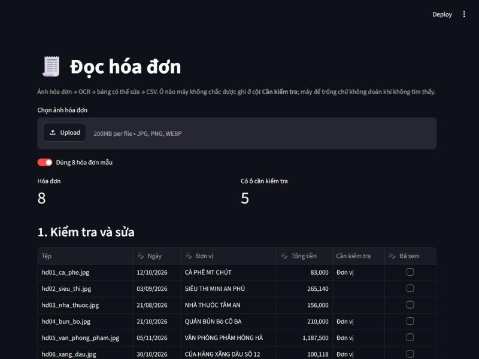

# 01 · Đọc hóa đơn

Chuyển ảnh hóa đơn thành bảng có thể sửa, và chỉ ra ô nào cần người kiểm tra.

**Trạng thái:** ✅ Chạy được · trên 8 hóa đơn mẫu: Ngày 8/8, Tổng tiền 8/8, không ô nào sai mà lọt lưới



## Bài toán

Nhập tay thông tin từ hóa đơn giấy tốn thời gian và dễ sai. Dự án đọc ảnh hóa đơn, lấy ra các trường chính và xuất thành bảng để người dùng kiểm tra rồi lưu.

## Luồng xử lý

1. Nhận ảnh hóa đơn.
2. **OCR** bằng PaddleOCR, rồi **gom các đoạn chữ cùng hàng** thành dòng (nhãn bên trái, số tiền bên phải), có chỉnh góc nghiêng của ảnh chụp.
3. **Tách trường**: Ngày, Đơn vị (tên cửa hàng), Tổng tiền ([src/fields.py](src/fields.py)).
4. **Đánh dấu ô cần kiểm tra** khi không tìm thấy hoặc có dấu hiệu OCR đọc sai. Không đoán khi không chắc.
5. Gom nhiều hóa đơn vào một bảng (Pandas).
6. **Kiểm tra** trên giao diện: bảng sửa được, đặt cạnh ảnh gốc và chữ máy đọc ([app.py](app.py)).
7. **Xuất CSV** (UTF-8 có BOM để Excel mở đúng tiếng Việt).

## Kết quả

Trên 8 hóa đơn mẫu (`python -m src.evaluate`):

| Trường | Đúng | Bị đánh dấu kiểm tra | Sai lọt lưới |
|---|---|---|---|
| Ngày | 8/8 | 0 | 0 |
| Tổng tiền | 8/8 | 0 | 0 |
| Đơn vị (đúng khi bỏ dấu) | 7/8 | 5 | 0 |
| Đơn vị (đúng cả dấu) | 1/8 | 5 | 3 |

**"Sai lọt lưới"** là ô sai mà không bị đánh dấu, loại lỗi nguy hiểm nhất vì người dùng không có lý do để xem lại. Mục tiêu của dự án là đưa cột này về 0, không phải đạt 100% đúng.

> Tám hóa đơn là quá ít để kết luận về độ chính xác. Các con số trên chủ yếu cho thấy cách đánh giá và những kiểu lỗi đã gặp.

## Những quyết định kỹ thuật

**Chọn mô hình OCR.** `lang="vi"` mặc định dùng PP-OCRv6 medium. Đã so 5 cấu hình trên cùng ảnh:

| Mô hình | Thời gian/ảnh (CPU) | Tên đơn vị đọc được |
|---|---|---|
| PP-OCRv6 medium (mặc định) | ~20 giây | VĂN PHÒNG PHÁM HÒNG HÀ |
| latin PP-OCRv5 mobile | ~4,5 giây | VN PHNG PHM HNG HÀ |
| **PP-OCRv6 small** (đang dùng) | **~3 giây** | VĂN PHÒNG PHÅM HÒNG HÀ |

**Chỉnh góc nghiêng trước khi gom dòng.** Ảnh nghiêng 3 độ là đủ để số tiền của dòng "Tiền khách đưa" ghép nhầm lên dòng "Tổng cộng". Tổng tiền khi đó sai mà trông hoàn toàn hợp lệ. [src/ocr.py](src/ocr.py) ước lượng góc nghiêng từ khung chữ rồi xoay ngược lại trước khi so độ cao (có test trong [tests/test_group_lines.py](tests/test_group_lines.py)).

**So khớp nhãn khi OCR làm rơi dấu.** OCR đọc số gần như hoàn hảo nhưng hay làm rơi nguyên âm mang hai lớp dấu: "Tổng cộng" thành "Tồng cng", "Tiền khách đưa" thành "Tin khach dura". Nhãn được bỏ dấu rồi so gần đúng, và mỗi nhãn được xếp vào nhóm có cụm từ giống nó **nhất**: "con phai tra" giống "phai tra" tới 80%, nếu chỉ so ngưỡng sẽ bị nhận nhầm.

**Chọn tổng tiền.** Ưu tiên số khách thực trả (Thanh toán, Phải trả, Total) vì đã trừ chiết khấu và cộng VAT, sau đó mới tới tổng trước giảm trừ (Tổng cộng, Tổng tiền). "Còn phải trả" sau đặt cọc không phải tổng. Hai dòng cùng loại mà khác số thì không đoán, để trống cho người kiểm tra.

**Khi nào đánh dấu tên đơn vị.** Độ tin cậy OCR dưới 0.95, có chữ không thuộc tiếng Việt (Å, ū), hoặc có từ không chứa nguyên âm ("MT"). Âm tiết tiếng Việt nào cũng có nguyên âm, nên từ thiếu nguyên âm là dấu hiệu OCR đã làm rơi chữ.

## Hạn chế

- **Tên đơn vị sai dấu nhưng trông hợp lệ** ("SIÊU THI" thay vì "SIÊU THỊ", "NHÀ THUÓC") không bị phát hiện. Nên luôn liếc qua cột Đơn vị. Muốn bắt được cần từ điển âm tiết tiếng Việt hoặc mô hình ngôn ngữ.
- Ảnh mẫu được tạo từ font máy tính. Hóa đơn thật in nhiệt bị nhạt, nhăn, gập sẽ khó hơn nhiều.
- Nhận diện nhãn dựa trên danh sách từ khóa. Hóa đơn ghi tổng bằng nhãn lạ sẽ được để trống và đánh dấu kiểm tra.

## Dữ liệu mẫu

- [data/receipts/](data/receipts/): 8 ảnh hóa đơn tự sinh bằng [src/make_receipts.py](src/make_receipts.py), giả lập ảnh chụp (nghiêng, mờ, nhiễu). Mỗi tờ có một kiểu khó: 6 cách ghi ngày, số tiền dùng `.` hoặc `,`, chiết khấu, VAT, đặt cọc, tiền khách đưa, hai ngày trên cùng tờ.
- [data/truth.csv](data/truth.csv): đáp án.
- [data/ocr_snapshot.json](data/ocr_snapshot.json): kết quả OCR thật của 8 ảnh, để test và đánh giá chạy trong một giây mà không cần Paddle.

Không dùng hóa đơn thật.

## Cách chạy

Từ thư mục `01-doc-hoa-don`:

```bash
python -m venv .venv
.venv\Scripts\activate          # Windows
# source .venv/bin/activate     # macOS / Linux
pip install -r requirements.txt

streamlit run app.py            # giao diện kiểm tra ở http://localhost:8501
python -m src.read_receipts     # đọc data/receipts, ghi output/hoa_don.csv
python -m src.evaluate          # bảng kết quả ở trên
pytest                          # chạy test
```

Lần chạy OCR đầu tiên sẽ tải mô hình (~31 MB) vào `models/paddlex/` trong thư mục dự án.

Đọc thư mục ảnh của bạn: `python -m src.read_receipts duong/dan/thu-muc -o output/thang10.csv`.

**Lưu ý trên Windows:** Paddle 3.3 báo lỗi `ConvertPirAttribute2RuntimeAttribute not support` khi bật oneDNN trên CPU, nên dự án tắt oneDNN (`enable_mkldnn=False` trong [src/ocr.py](src/ocr.py)).

## Cấu trúc

```
01-doc-hoa-don/
├── app.py                  giao diện kiểm tra (Streamlit)
├── data/
│   ├── receipts/           8 ảnh hóa đơn mẫu
│   ├── truth.csv           đáp án
│   └── ocr_snapshot.json   kết quả OCR đã lưu
├── src/
│   ├── ocr.py              gọi PaddleOCR, gom dòng, chỉnh nghiêng
│   ├── fields.py           tách ngày, đơn vị, tổng tiền và đánh dấu kiểm tra
│   ├── read_receipts.py    CLI đọc cả thư mục ra CSV
│   ├── evaluate.py         so với đáp án
│   └── make_receipts.py    sinh ảnh hóa đơn mẫu
└── tests/                  pytest
```

## Công nghệ

Python 3.12 · PaddleOCR 3.7 (PP-OCRv6 small) · Pandas · Streamlit · pytest
