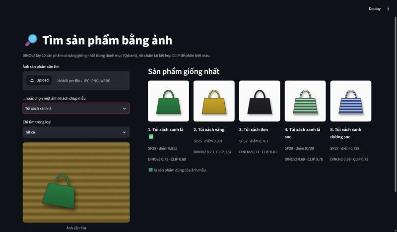

# 02 · Tìm sản phẩm bằng ảnh

Tìm những sản phẩm giống nhất trong danh mục từ một tấm ảnh khách tự chụp.

**Trạng thái:** ✅ Chạy được · trên 48 ảnh khách chụp: sản phẩm đúng đứng đầu 85%, nằm trong top 5 100%



## Bài toán

Khách thường không biết tên sản phẩm nhưng có sẵn một tấm ảnh. Ảnh khách chụp khác hẳn ảnh trong danh mục: nền bàn gỗ hay vải thay vì nền trắng, đặt lệch, xoay nghiêng, ánh đèn ám vàng hoặc ám xanh. Dự án nhận ảnh đó và trả về 5 sản phẩm giống nhất.

## Luồng xử lý

1. **Tạo chỉ mục** ([src/build_index.py](src/build_index.py)): biến mỗi ảnh danh mục thành vector bằng DINOv2 và CLIP, rồi lưu vào Qdrant chạy cục bộ ([src/index.py](src/index.py)). Mỗi sản phẩm là một điểm mang nhiều vector có tên, kèm payload (tên, loại, màu, hoa văn).
2. **Thêm viền cho vuông** ảnh cần tìm, không cắt giữa ([src/embedders.py](src/embedders.py)).
3. **Lọc rộng:** DINOv2 lấy 10 sản phẩm có dáng giống nhất. Có thể chỉ tìm trong một loại bằng bộ lọc payload của Qdrant.
4. **Chấm kỹ:** tính thêm độ giống theo CLIP cho 10 ứng viên, cộng hai điểm rồi xếp lại ([src/search.py](src/search.py)).
5. Trả về 5 sản phẩm đầu, kèm điểm của từng mô hình để người dùng thấy vì sao ([app.py](app.py)).

## Kết quả

48 ảnh khách chụp, tìm trong danh mục 48 sản phẩm (`python -m src.evaluate`).

**Từng mô hình riêng:**

| Cách biến ảnh thành vector | Đúng sản phẩm @1 | Đúng sản phẩm @5 | Đúng loại @1 | Đúng màu @1 | ms/ảnh (CPU) |
|---|---|---|---|---|---|
| Biểu đồ màu HSV (mốc so sánh, không học máy) | 10% | 50% | 19% | 54% | 2 |
| DINOv2-small | 69% | 98% | **96%** | 71% | 66 |
| CLIP ViT-B/32 | 65% | 90% | 85% | **83%** | 54 |

**Hai bước: DINOv2 lấy 10 ứng viên, rồi chấm lại:**

| Cách chấm lại | Đúng sản phẩm @1 | Đúng sản phẩm @5 | Đúng loại @1 | Đúng màu @1 |
|---|---|---|---|---|
| Không chấm lại (chỉ DINOv2) | 69% | 98% | 96% | 71% |
| Chỉ CLIP trong 10 ứng viên | 67% | 94% | 88% | 79% |
| **Cộng thẳng điểm 50/50** (đang dùng) | **85%** | **100%** | **98%** | 85% |
| Chuẩn hóa về 0..1 rồi cộng 50/50 | 79% | 100% | 94% | **88%** |
| Chuẩn hóa về 0..1, DINOv2 30% / CLIP 70% | 75% | 98% | 92% | 88% |
| Theo thứ hạng (RRF) | 73% | 100% | 94% | 83% |

> 48 ảnh là ít: mỗi ảnh tương đương hơn 2 điểm phần trăm. Bảng trên cho thấy hướng chênh lệch giữa các cách làm, không phải độ chính xác khi chạy thật.

## Những quyết định kỹ thuật

**DINOv2 nhận dáng, CLIP nhận màu.** DINOv2 tự học bằng cách so hai bản biến đổi của cùng một ảnh, trong đó có đổi màu ngẫu nhiên, nên nó học cách bỏ qua màu: đúng loại 96% nhưng đúng màu chỉ 71%. Lỗi điển hình là "Túi xách vàng" bị nhầm thành "Túi xách xanh lá". CLIP học từ ảnh kèm chú thích, mà chú thích hay nhắc màu ("a red mug"), nên giữ màu tốt hơn nhưng hay nhầm loại khi cùng màu, cùng hoa văn: "Cốc trắng chấm bi" thành "Chai nước trắng chấm bi". Hai mô hình sai ở những chỗ khác nhau, nên kết hợp chúng có lợi.

**Lọc rộng, chấm kỹ.** DINOv2 lấy 10 ứng viên từ chỉ mục (sản phẩm đúng nằm trong top 5 của nó 98% số lần), rồi mới dùng CLIP để xếp lại. Hệ thống tìm kiếm thật thường làm như vậy: bước đầu phải nhanh trên cả danh mục, còn bước sau chỉ chạy trên vài ứng viên nên có thể dùng cách chấm đắt hơn.

**Cộng thẳng điểm, không chuẩn hóa.** Trong 10 ứng viên, điểm DINOv2 trải trung bình 0.17 và CLIP 0.15, đã cùng thang nên cộng 50/50 là cân. Chuẩn hóa min-max nghe hợp lý hơn nhưng lại kém đi (79%). Nó luôn kéo ứng viên thấp nhất về 0 và cao nhất về 1, nên khi 10 ứng viên gần như hòa nhau, một khác biệt 0.01 cũng bị phóng thành cả thang. RRF chỉ dùng thứ hạng nên mất thông tin "DINOv2 chắc chắn tới mức nào". Có test cho cả hai tình huống trong [tests/test_rerank.py](tests/test_rerank.py).

**Thêm viền thay vì cắt giữa.** Bộ tiền xử lý của DINOv2 và CLIP cắt lấy phần giữa ảnh. Ảnh khách chụp khổ 4:3 với sản phẩm đặt lệch có thể bị cắt mất một phần sản phẩm, nên ảnh được thêm viền màu trung bình cho vuông trước.

**Một collection, nhiều vector có tên.** Mỗi sản phẩm mang vector của cả ba cách trong cùng một điểm Qdrant. Nhờ vậy có thể so các mô hình trên cùng một chỉ mục, và lấy lại vector CLIP của 10 ứng viên bằng một lần gọi.

**Không tải mô hình hai lần.** Nhánh chính của CLIP trên Hugging Face chỉ có `pytorch_model.bin`. Khi nạp file này, transformers chạy ngầm một luồng tải thêm bản `model.safetensors` (605 MB) từ PR chuyển đổi "cho lần sau", nhưng lần sau vẫn nạp `.bin`. Đặt `DISABLE_SAFETENSORS_CONVERSION=1` giảm thư mục mô hình từ 1,3 GB xuống 662 MB.

## Hạn chế

- **7/48 ảnh vẫn sai ở vị trí đầu**, nhưng sản phẩm đúng luôn nằm trong top 5. Sáu ảnh nhầm màu trong cùng loại, phần lớn do ánh sáng ám màu ("Túi xách vàng" ra "Túi xách xanh lá"). Một ảnh nhầm loại ("Chai nước đen sọc" ra "Cốc trắng sọc"), và chọn bộ lọc "Chai nước" là sửa được.
- **Ảnh mẫu là hình vẽ đơn giản.** Sản phẩm thật có logo, chất liệu, nếp gấp, và danh mục thật có hàng nghìn mẫu gần giống nhau. Ở quy mô đó, cần đánh giá lại và có thể phải tinh chỉnh mô hình trên ảnh của chính cửa hàng.
- **Mỗi ảnh chỉ nên có một sản phẩm.** Ảnh có nhiều món cần thêm bước phát hiện vật thể và cắt từng món trước khi tìm.
- **Qdrant chạy theo thư mục chỉ cho một tiến trình mở.** Đang mở giao diện thì không chạy được `build_index` hay `evaluate`. Khi chạy thật, nên dựng Qdrant server.

## Dữ liệu mẫu

Tự sinh bằng [src/make_catalog.py](src/make_catalog.py):

- [data/catalog/](data/catalog/) và [data/catalog.csv](data/catalog.csv): 48 sản phẩm (6 loại × 8 mẫu màu và hoa văn) trên nền trắng, giống ảnh trên trang bán hàng. Danh mục cố ý có nhiều cặp dễ nhầm: cùng loại cùng màu khác hoa văn, hoặc cùng màu cùng hoa văn khác loại.
- [data/queries/](data/queries/) và [data/queries.csv](data/queries.csv): mỗi sản phẩm một ảnh như khách tự chụp (nền gỗ, vải hoặc màu bất kỳ, đặt lệch, xoay tới ±20°, ánh sáng ám ±12%), kèm đáp án.

## Cách chạy

Từ thư mục `02-tim-san-pham-bang-anh`:

```bash
python -m venv .venv
.venv\Scripts\activate          # Windows
# source .venv/bin/activate     # macOS / Linux
pip install -r requirements.txt

python -m src.build_index       # tạo chỉ mục Qdrant trong qdrant_storage/
streamlit run app.py            # giao diện ở http://localhost:8501
python -m src.search data/queries/SP29_khach.jpg   # tìm từ dòng lệnh
python -m src.evaluate          # bảng kết quả ở trên
pytest                          # chạy test (không cần mô hình)
```

Lần chạy đầu sẽ tải DINOv2-small (~90 MB) và CLIP ViT-B/32 (~600 MB) vào `models/` trong thư mục dự án. `requirements.txt` cài bản PyTorch chỉ dùng CPU.

Tắt giao diện trước khi chạy `build_index` hoặc `evaluate` (xem phần Hạn chế).

## Cấu trúc

```
02-tim-san-pham-bang-anh/
├── app.py                giao diện tìm kiếm (Streamlit)
├── data/
│   ├── catalog/          48 ảnh sản phẩm
│   ├── queries/          48 ảnh khách chụp
│   ├── catalog.csv       thông tin sản phẩm
│   └── queries.csv       đáp án
├── src/
│   ├── embedders.py      biểu đồ màu, DINOv2, CLIP
│   ├── index.py          chỉ mục Qdrant (vector có tên, lọc theo loại)
│   ├── search.py         tìm hai bước và chấm lại
│   ├── build_index.py    tạo chỉ mục
│   ├── evaluate.py       so các mô hình và cách chấm lại
│   ├── make_catalog.py   sinh dữ liệu mẫu
│   └── data.py           đọc danh mục
└── tests/                pytest
```

## Công nghệ

Python 3.12 · PyTorch 2.15 (CPU) · Hugging Face Transformers (DINOv2, CLIP) · Qdrant (chạy cục bộ) · Pandas · Streamlit · pytest
