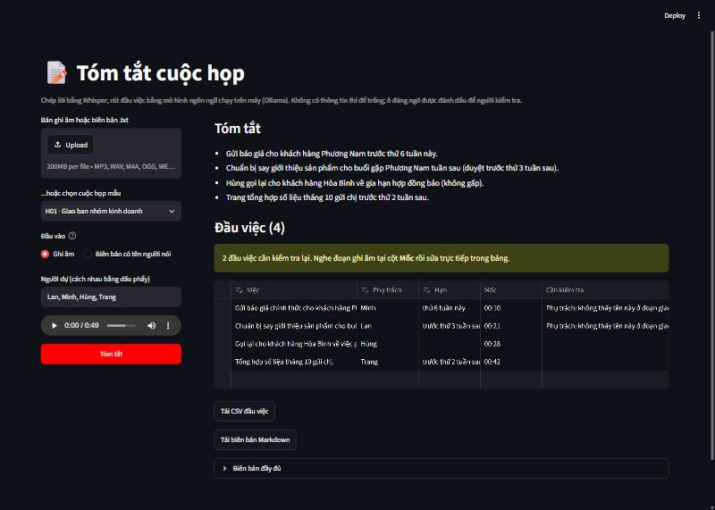

# 04 · Tóm tắt cuộc họp

Từ bản ghi âm tới danh sách đầu việc, chạy hoàn toàn trên máy, không cần khóa API.

**Trạng thái:** ✅ Chạy được · trên 6 cuộc họp mẫu (19 đầu việc): tìm thấy 18/19 việc từ ghi âm, không ô nào sai lọt lưới



## Bài toán

Sau cuộc họp, việc ghi lại ai làm gì, khi nào thường bị quên hoặc ghi thiếu. Dự án biến bản ghi âm thành biên bản có mốc thời gian, rồi rút ra tóm tắt và danh sách đầu việc: **Việc · Phụ trách · Hạn · Mốc**.

Quy tắc: **không có thông tin thì để trống.** Không tự suy ra người phụ trách hay hạn chót khi cuộc họp không nhắc tới. Ô nào đáng ngờ thì gắn cờ để người kiểm tra, kèm mốc thời gian để nghe lại đúng đoạn đó.

## Luồng xử lý

1. Nhận **bản ghi âm** (mp3, wav, m4a...) hoặc **biên bản .txt** dạng `[mm:ss] Tên: lời nói` (giống bản xuất từ Teams, Google Meet).
2. **Chép lời** bằng Whisper large-v3-turbo (faster-whisper, chạy trên CPU), có mốc thời gian từng đoạn ([src/transcribe.py](src/transcribe.py)). Tên người dự họp được đưa vào câu mồi để Whisper nghe đúng tên.
3. **Rút tóm tắt và đầu việc** bằng qwen3.5:4b chạy qua Ollama. Mô hình phải trả JSON đúng schema ([src/extract.py](src/extract.py)).
4. **Soát từng đầu việc với biên bản** (`review`): gắn cờ người phụ trách hay hạn chót không kiểm chứng được ở đoạn giao việc.
5. **Kiểm tra trên giao diện**, sửa trực tiếp trong bảng, xuất CSV và biên bản Markdown ([app.py](app.py)).

## Kết quả

6 cuộc họp mẫu, 19 đầu việc (`python -m src.evaluate`).

**Chép lời:**

| Whisper | Gợi ý tên người dự | Tỉ lệ lỗi từ (WER) | Tên chép đúng | Giây xử lý / phút ghi âm (CPU) |
|---|---|---|---|---|
| small | không | 21% | 5/16 | 27 |
| small | có | 19% | 6/16 | 26 |
| large-v3-turbo | không | 11% | 8/16 | 50 |
| **large-v3-turbo** | **có** | **10%** | **10/16** | 46 |

WER tính cả khác biệt cách viết số ("thứ Sáu" và "thứ 6") nên cao hơn lỗi thật một chút. Con số đáng chú ý là **tên người**: kể cả cấu hình tốt nhất vẫn chép "Minh gửi báo giá" thành "mình gửi báo giá", tức là mất luôn người phụ trách.

**Rút đầu việc:**

| Mô hình | Đầu vào | Tìm thấy | Thừa (có cờ) | Phụ trách đúng | Hạn đúng | Báo nhầm | Sai lọt lưới | Giây/cuộc họp |
|---|---|---|---|---|---|---|---|---|
| qwen3.5:2b | Biên bản có tên người nói | 11/19 | 0 (0) | 10/11 | 10/11 | 3 | 1 | 26 |
| qwen3.5:2b | Chép từ ghi âm | 5/19 | 0 (0) | 2/5 | 3/5 | 4 | 0 | 14 |
| **qwen3.5:4b** | Biên bản có tên người nói | **17/19** | 1 (1) | **17/17** | 14/17 | 0 | **0** | 44 |
| **qwen3.5:4b** | Chép từ ghi âm | **18/19** | 3 (3) | 6/18 | 15/18 | 1 | **0** | 40 |

- **Sai lọt lưới** là ô ghi sai mà không bị gắn cờ, loại lỗi nguy hiểm nhất vì người dùng không có lý do để xem lại. Mục tiêu là đưa cột này về 0, giống [dự án 01](../01-doc-hoa-don/).
- **Báo nhầm** là ô đúng nhưng vẫn bị gắn cờ. Báo nhầm nhiều thì người dùng quen bỏ qua cảnh báo.
- Từ ghi âm, người phụ trách chỉ đúng 6/18. 12 ô còn lại: 6 ô để trống (đúng quy tắc khi không biết ai nói) và 6 ô ghi sai nhưng đều bị gắn cờ ("Em", "Chị", "Mọc" thay vì Ngọc, "Lan" thay vì Hùng).

> 6 cuộc họp, 19 đầu việc là rất ít; mỗi việc tương đương 5 điểm phần trăm. Các con số cho thấy kiểu lỗi và hướng chênh lệch, không phải độ chính xác khi dùng thật.

## Những quyết định kỹ thuật

**Chạy trên máy thay vì gọi API.** Ghi âm cuộc họp là dữ liệu nhạy cảm; chạy trên máy thì không gửi đi đâu và không tốn phí theo lượt. Đổi lại, phải chọn mô hình vừa với máy (RTX 3050 4 GB, RAM 16 GB): qwen3.5:4b (3,3 GB) chạy được, bản 2b nhanh hơn nhưng có lần bỏ sót gần hết việc.

**Thứ tự trường trong schema thay đổi kết quả.** Mô hình sinh JSON lần lượt từng trường, nên thứ tự cũng là thứ tự "suy nghĩ". Bảng dưới là qwen3.5:4b qua từng lần sửa (tìm thấy trên biên bản có tên / từ ghi âm; báo nhầm trên biên bản có tên, cùng cách soát ở dưới):

| Thay đổi | Tìm thấy | Báo nhầm |
|---|---|---|
| Tóm tắt đứng trước đầu việc | 13/19 · 15/19 | (chưa có bước soát) |
| Đầu việc đứng trước tóm tắt | 16/19 · 16/19 | 12 |
| Mốc thời gian thay bằng số dòng | 13/19 · 13/19 | 0 |
| Bỏ câu "không có việc thì trả danh sách rỗng" | **17/19 · 18/19** | **0** |

- Khi tóm tắt đứng trước, có lần mô hình đưa hết việc vào tóm tắt rồi trả danh sách đầu việc rỗng.
- Hỏi "mốc thời gian" thì mô hình hay ghi hạn chót ("sáng thứ Năm") vào đó, vì trong tiếng Việt "mốc thời gian" cũng có thể hiểu là hạn. Không có mốc thì không soát được, nên 12 ô đúng bị báo nhầm. Biên bản được đánh số dòng và mô hình trả về **số dòng** (kiểu số nguyên, schema ép đúng kiểu); mốc mm:ss lấy từ chính dòng đó.
- Có câu "không có việc thì trả danh sách rỗng" (viết kiểu nào cũng vậy), mô hình trả rỗng cả với cuộc trao đổi có 3 việc. Bỏ đi thì đôi khi nó bịa việc ở cuộc họp không giao việc gì ("Họp lại để cập nhật tiến độ"), nên `review` gắn cờ mọi việc không có cả người phụ trách lẫn hạn.

**Soát lại bằng quy tắc, không bằng một lần gọi mô hình nữa** ([`review`](src/extract.py)). Một ô bị gắn cờ khi:

- Người phụ trách là đại từ ("Em", "Chị"), không có trong danh sách người dự, hoặc không thấy tên ở dòng giao việc và một dòng hai bên (và cũng không phải người nói ở đó, khi biên bản có tên người nói).
- Hạn chót không xuất hiện ở đoạn đó (so sau khi chuẩn hóa: "thứ 6" = "thứ Sáu", "mười lăm tháng mười một" = "15/11"), hoặc là câu không phải hạn ("khi nào tiện").
- Việc không có cả người phụ trách lẫn hạn.

So tên phải **giữ dấu**: bỏ dấu thì "mình" trùng "Minh". Lần đầu viết danh sách đại từ ở dạng bỏ dấu, tên Minh bị coi là đại từ ở mọi cuộc họp. Vùng soát ±1 dòng được chọn theo số đo: chỉ soát đúng dòng giao việc thì báo nhầm 2 lần (hạn nằm ở câu xác nhận ngay sau "Để em chuẩn bị slide"; người nhận là người vừa hỏi "Chị có cần em gửi số liệu không?"), ±1 dòng thì không lần nào, sai lọt lưới đều bằng 0. Đổi lại, hạn của một việc khác ở ngay dòng kề có thể lọt qua.

**Số dòng và mốc thời gian.** Biên bản chép từ ghi âm có mốc thời gian theo từng đoạn Whisper nghe được (lọc khoảng lặng bằng VAD), không theo từng lượt nói. Mốc là để nghe lại đoạn ghi âm, còn việc soát dùng số dòng.

**Ghép đầu việc với đáp án khi chấm điểm.** Lần chấm đầu ghép theo từ khóa, nên "Gửi tài liệu khóa đào tạo" bị ghép vào "Học khóa đào tạo", và "Sửa lỗi đam nhập" (lỗi chép lời) không khớp "đăng nhập". Bảng kết quả khi đó cho thấy lỗi mà mô hình không mắc. Bản sửa ([src/scoring.py](src/scoring.py)) xếp cặp theo từ khóa cộng độ giống của cả câu, và chấp nhận từ khóa sai một chút.

## Hạn chế

- **Không biết ai đang nói** (không có diarization). Từ ghi âm, "để em làm" không cho biết ai nhận việc, nên người phụ trách thường để trống hoặc bị gắn cờ. Nếu có biên bản kèm tên người nói (Teams, Google Meet xuất được), dùng biên bản đó sẽ tốt hơn nhiều: 17/17 so với 6/18.
- **Âm thanh mẫu quá sạch.** Một giọng đọc tổng hợp đổi cao độ, mỗi lượt một người, không nói chồng lên nhau. Họp thật có micro xa, tiếng ồn, nhiều người nói cùng lúc, tiếng địa phương.
- **Chậm trên máy cá nhân.** Chép lời mất khoảng 46 giây cho mỗi phút ghi âm trên CPU, rút đầu việc khoảng 40 giây mỗi cuộc họp. Cuộc họp một giờ sẽ dài hơn ngữ cảnh 8 192 token đang đặt, cần chia đoạn.
- **Tóm tắt chưa được đánh giá** bằng số liệu, và mang theo lỗi chép lời ("say" thay vì "slide").
- **Hạn giữ nguyên cách nói** ("thứ Sáu tuần này"), không đổi ra ngày cụ thể. Đổi ra ngày là một lần suy luận nữa có thể sai.
- **Mô hình nhỏ nhạy với câu chữ.** Thêm hay bớt một câu trong prompt làm số việc tìm thấy thay đổi vài việc; đổi mô hình hay prompt thì phải chạy lại đánh giá.

## Dữ liệu mẫu

- [data/meetings.json](data/meetings.json): kịch bản 6 cuộc họp tự viết và 19 đầu việc đúng. Mỗi cuộc họp gài vài bẫy: việc bị hủy giữa chừng, việc đã làm xong, việc được giao lại cho người khác, việc chưa ai nhận, câu nghe như hạn chót mà không phải ("khi nào tiện", "nghỉ phép cuối tháng"), và một cuộc họp không có đầu việc nào.
- [data/audio/](data/audio/): bản ghi âm đọc bằng Piper (giọng tiếng Việt vais1000), mỗi người một cao độ, thêm tiếng ồn nền. Tạo lại bằng [src/make_audio.py](src/make_audio.py).
- [data/transcripts/](data/transcripts/): biên bản chuẩn có tên người nói và mốc thời gian thật.
- [data/asr_snapshot.json](data/asr_snapshot.json), [data/llm_snapshot.json](data/llm_snapshot.json): kết quả Whisper và mô hình ngôn ngữ đã lưu, để đánh giá chạy trong vài giây mà không cần mô hình.

Không dùng cuộc họp thật.

## Cách chạy

### 1. Cài Ollama và mô hình ngôn ngữ

Tải Ollama ở [ollama.com/download](https://ollama.com/download), hoặc bản giải nén `ollama-windows-amd64.zip` trên [GitHub](https://github.com/ollama/ollama/releases) nếu không muốn cài. Muốn lưu mô hình ở ổ khác, đặt biến môi trường `OLLAMA_MODELS` trước khi chạy.

```bash
ollama serve                    # nếu Ollama chưa tự chạy
ollama pull qwen3.5:4b          # ~3,3 GB
```

### 2. Cài thư viện Python

Từ thư mục `04-tom-tat-cuoc-hop`:

```bash
python -m venv .venv
.venv\Scripts\activate          # Windows
# source .venv/bin/activate     # macOS / Linux
pip install -r requirements.txt
```

### 3. Chạy

```bash
streamlit run app.py            # giao diện ở http://localhost:8501
python -m src.minutes data/audio/H01.mp3 --nguoi-du Lan Minh Hùng Trang
python -m src.minutes data/transcripts/H02.txt --nguoi-du Phong Ngọc Tuấn Vy -o output/H02.md
python -m src.evaluate          # bảng kết quả ở trên, đọc từ bản lưu, không cần mô hình
python -m src.evaluate --refresh-asr --refresh-llm   # chạy lại mô hình (khoảng 20 phút)
pytest                          # chạy test, không cần mô hình
```

- Lần chép lời đầu tiên sẽ tải Whisper large-v3-turbo (~1,6 GB) vào `models/` trong thư mục dự án.
- Dùng mô hình Ollama khác: đặt biến môi trường `MEETING_LLM`, hoặc `--model` với `src.minutes`.
- `requirements.txt` ghim `av==18.1.0`: faster-whisper 1.2.1 gọi một tham số đã bị bỏ ở av 19.

## Cấu trúc

```
04-tom-tat-cuoc-hop/
├── app.py                giao diện (Streamlit)
├── data/
│   ├── meetings.json     kịch bản và đáp án
│   ├── audio/            6 bản ghi âm mẫu
│   ├── transcripts/      biên bản chuẩn
│   ├── asr_snapshot.json kết quả Whisper đã lưu
│   └── llm_snapshot.json kết quả mô hình ngôn ngữ đã lưu
├── src/
│   ├── transcribe.py     chép lời (faster-whisper)
│   ├── extract.py        rút đầu việc (Ollama) và soát lại
│   ├── minutes.py        CLI: ghi âm hoặc biên bản -> Markdown, CSV
│   ├── evaluate.py       đánh giá hai bước
│   ├── scoring.py        WER, so khớp đầu việc, so hạn chót
│   ├── make_audio.py     đọc kịch bản thành ghi âm (Piper)
│   └── data.py           đọc/ghi biên bản
└── tests/                pytest
```

## Công nghệ

Python 3.12 · faster-whisper (Whisper large-v3-turbo) · Ollama (Qwen 3.5 4B) · Pydantic · Piper TTS · Pandas · Streamlit · pytest
