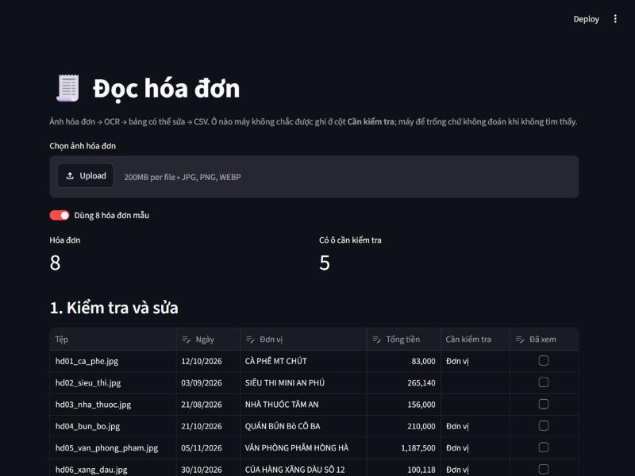
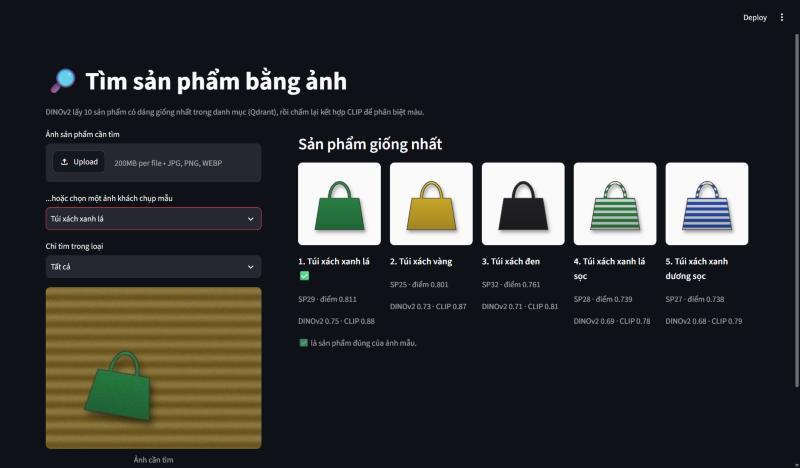
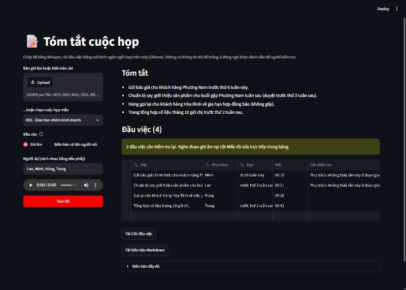

# applied-ai-projects

[](https://github.com/NovWyatt/applied-ai-projects/actions/workflows/tests.yml)

Bộ 5 dự án **AI ứng dụng** giải các bài toán nghiệp vụ quen thuộc: đọc hóa đơn, tìm sản phẩm bằng ảnh, phân loại ticket, tóm tắt cuộc họp và gợi ý bài viết. Tất cả chạy trên một laptop cá nhân, không cần khóa API.

> Five small, self-contained applied-AI projects on Vietnamese business data: receipt OCR, visual product search, ticket routing, meeting minutes and article recommendations. Each one compares several approaches on its own evaluation set, picks by the numbers, and flags uncertain outputs for human review instead of guessing.

## Các dự án

| # | Dự án | Bài toán | Kết quả trên dữ liệu mẫu | Công nghệ chính |
|---|-------|----------|--------------------------|-----------------|
| 1 | [Đọc hóa đơn](01-doc-hoa-don/) | Ảnh hóa đơn → bảng sửa được, xuất CSV | Ngày và tổng tiền đúng 8/8 hóa đơn, không ô nào sai lọt lưới | PaddleOCR, Pandas, Streamlit |
| 2 | [Tìm sản phẩm bằng ảnh](02-tim-san-pham-bang-anh/) | Ảnh khách tự chụp → 5 sản phẩm giống nhất trong danh mục | Đúng sản phẩm ở vị trí đầu 85% (chỉ dùng DINOv2: 69%), trong top 5: 100% | DINOv2, CLIP, Qdrant, Streamlit |
| 3 | [Phân loại ticket](03-phan-loai-ticket/) | Ticket mới → nhóm tiếp nhận, hoặc "Cần kiểm tra" | Tự chuyển 70% ticket với độ chính xác 99%, phần còn lại để người quyết | scikit-learn, FastAPI |
| 4 | [Tóm tắt cuộc họp](04-tom-tat-cuoc-hop/) | Bản ghi âm → tóm tắt và đầu việc (việc, phụ trách, hạn) | Tìm thấy 18/19 việc từ ghi âm, không ô nào sai lọt lưới; chạy hoàn toàn trên máy | faster-whisper, Ollama (Qwen 3.5), Streamlit |
| 5 | [Gợi ý bài viết](05-goi-y-bai-viet/) | Lịch sử đọc → bài gợi ý kèm lý do | Hit@5 54% (chọn ngẫu nhiên khoảng 10%); với người đổi sở thích 50%, so với 10% khi không tính độ mới | scikit-learn, Pandas |

| Đọc hóa đơn | Tìm sản phẩm bằng ảnh | Tóm tắt cuộc họp |
|---|---|---|
|  |  |  |

## Cách làm chung

- **Đo trước khi chọn.** Mỗi dự án so vài phương án trên cùng một bộ đánh giá rồi chọn theo số liệu, và README giữ lại cả những phương án thua. Ví dụ: chuẩn hóa điểm nghe hợp lý hơn nhưng kém hơn cộng thẳng (dự án 2), ngưỡng tự chuyển ticket chọn từ bảng đánh đổi chứ không theo cảm tính (dự án 3), thứ tự trường trong JSON schema làm thay đổi số việc tìm thấy (dự án 4).
- **Theo dõi "sai lọt lưới".** Đó là ô sai mà không bị đánh dấu, loại lỗi nguy hiểm nhất vì người dùng không có lý do để xem lại. Mục tiêu là đưa con số này về 0, không phải đạt 100% đúng. Không chắc thì để trống hoặc chuyển cho người kiểm tra, không đoán bừa.
- **Dữ liệu mẫu tự tạo, có gài bẫy, có đáp án.** Hóa đơn nghiêng và có tiền khách đưa, ảnh sản phẩm chụp dưới ánh đèn ám màu, cuộc họp có việc bị hủy giữa chừng. Không có dữ liệu thật trong repo.
- **Đánh giá chạy trong vài giây.** Kết quả của các mô hình nặng (OCR, Whisper, mô hình ngôn ngữ) được lưu lại, nên bảng đánh giá và test không cần tải mô hình.
- **Nói rõ hạn chế.** Mỗi bộ dữ liệu mẫu chỉ vài chục mẫu. Các con số cho thấy kiểu lỗi và hướng chênh lệch giữa các phương án, không phải độ chính xác khi dùng thật.

## Cách chạy

Mỗi dự án có môi trường Python riêng, vì PaddlePaddle và PyTorch dễ xung đột phiên bản khi cài chung. Đã chạy thử với Python 3.12 trên Windows.

```bash
cd 03-phan-loai-ticket
python -m venv .venv
.venv\Scripts\activate          # Windows
# source .venv/bin/activate     # macOS / Linux
pip install -r requirements.txt
pytest
```

Cách chạy cụ thể nằm trong README của từng thư mục. Mô hình tải về nằm trong `models/` của từng dự án (không commit). Dự án 4 cần cài thêm [Ollama](https://ollama.com).

GitHub Actions chạy test của cả 5 dự án mỗi lần push ([.github/workflows/tests.yml](.github/workflows/tests.yml)). Test không tải mô hình nên không cần cài PaddlePaddle, PyTorch hay Whisper.

## Ghi nguồn

Ý tưởng 5 bài toán lấy cảm hứng từ series infographic của Quang Huy (@quanghuyai). Mã nguồn và dữ liệu mẫu trong repo này được viết riêng.

## Giấy phép

[MIT](LICENSE)
